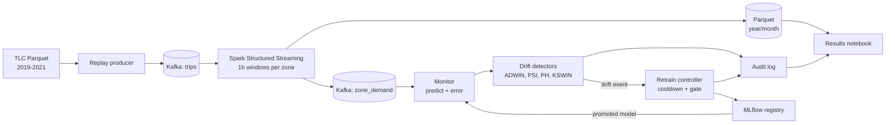

# Concept Drift Detection on NYC Taxi Demand Streams

A model that forecasts hourly taxi demand per NYC zone gets worse as travel patterns change.
This project streams NYC TLC trip data through Kafka and Spark, watches the model with streaming
drift detectors (ADWIN, PSI, Page-Hinkley, KSWIN), measures detection delay and false alarms,
retrains automatically when drift is confirmed, and checks whether drift hurts some boroughs more
than others.

Team: Rahul Saran Sharma, Rahul Prasanna, Raghav U. Full plan: [docs/project_plan.pdf](docs/project_plan.pdf).

> Status: pipeline, detectors, retraining and experiments are implemented, with results in `results/` and `notebooks/results.ipynb`. Still open: technical report, Spark scaling measurements, final model and data cards. See `docs/demo_video.md` for the live demo.

## Architecture



## Repository layout

| Path | What | Owner |
|---|---|---|
| `docker-compose.yml`, `Dockerfile` | Kafka, Spark master/workers, MLflow, Jupyter, pipeline services | Rahul Saran Sharma |
| `scripts/download_data.py` | Downloads TLC Parquet + zone lookup into `data/raw` | Rahul Saran Sharma |
| `src/taxidrift/data/reference.py` | Spark batch job: trips -> zone-hour counts | Rahul Saran Sharma |
| `src/taxidrift/stream/` | Kafka producer, Spark streaming aggregator | Rahul Saran Sharma |
| `src/taxidrift/drift/` | Detectors (shared `DriftDetector` interface), drift injector | Rahul Prasanna |
| `src/taxidrift/model/` | Features, LightGBM model, seasonal-naive baseline | Raghav U |
| `src/taxidrift/retrain/` | Retraining policies and controller (MLflow) | Raghav U |
| `src/taxidrift/monitor/` | Online monitor service, audit log | Raghav U + Rahul Prasanna |
| `src/taxidrift/eval/metrics.py` | Shared scoring: detection delay, false alarms, MAE, sMAPE | shared |
| `src/taxidrift/schemas.py` | Kafka message formats (agree before changing) | shared |
| `experiments/` | `run_detectors.py`, `run_retraining.py`, `run_scaling.py` -> `results/` | one each |
| `notebooks/results.ipynb` | All report figures, built from `results/` | shared |
| `docs/` | Plan, model card, data card, report | shared |
| `configs/default.yaml` | Every tunable setting; `docker.yaml` overrides for containers | shared |

## Setup

The tested way to run this is natively on Linux or WSL (Ubuntu 24.04, Python 3.12, Java 21) with no Docker:

```bash
bash scripts/pipeline.sh setup
```

```bash
export TAXIDRIFT_CONFIG=$PWD/configs/wsl.yaml
```

```bash
bash scripts/pipeline.sh data
```

```bash
bash scripts/pipeline.sh up
```

```bash
bash scripts/pipeline.sh demo
```

`setup` installs the Python environment and Kafka 4.1.2 into `~/taxidrift`. `data` downloads the 2.1 GB of TLC files, builds the zone-hour dataset with Spark and trains the model. `up` starts Kafka. `demo` replays March-April 2020 through Kafka, Spark and the monitor.

Experiments (each writes CSVs to `results/`):

```bash
~/taxidrift-venv/bin/python experiments/run_detectors.py --seeds 8
```

```bash
~/taxidrift-venv/bin/python experiments/run_retraining.py
```

```bash
~/taxidrift-venv/bin/python experiments/run_scaling.py batch
```

`docker-compose.yml` describes an equivalent containerised stack, but **it has not been run** because Docker was not available on the development machine.

## Working together

- Branch per piece of work: `feat/<area>-<short-name>` (e.g. `feat/drift-adwin`), open a pull request into `main`, one teammate reviews.
- `pytest` must pass before merging. Tests for unfinished modules skip automatically; when you implement a module, its tests start running.
- Keep settings in `configs/default.yaml`, not hard-coded. Experiments write CSVs to `results/<experiment>/`; the notebook only reads those.
- Never commit data, `results/`, `mlflow/` or `.env` (already in `.gitignore`).
- Changing `schemas.py` or the `DriftDetector` interface affects everyone: mention it in the PR title.

## Deliverables (Option A)

- [ ] README with architecture diagram and setup steps
- [ ] Reproducible pipeline (Docker Compose + scripts)
- [ ] Results notebook
- [ ] 3-5 page technical report (`docs/report.pdf`)
- [ ] Model card and data card (`docs/model_card.md`, `docs/data_card.md`)
- [ ] 3-minute demo video (link here)

## Data

NYC TLC Yellow Taxi Trip Records, published by the NYC Taxi and Limousine Commission
(https://www.nyc.gov/site/tlc/about/tlc-trip-record-data.page). Only pickup time and pickup zone are
used, aggregated to zone-hour counts. See [docs/data_card.md](docs/data_card.md).
